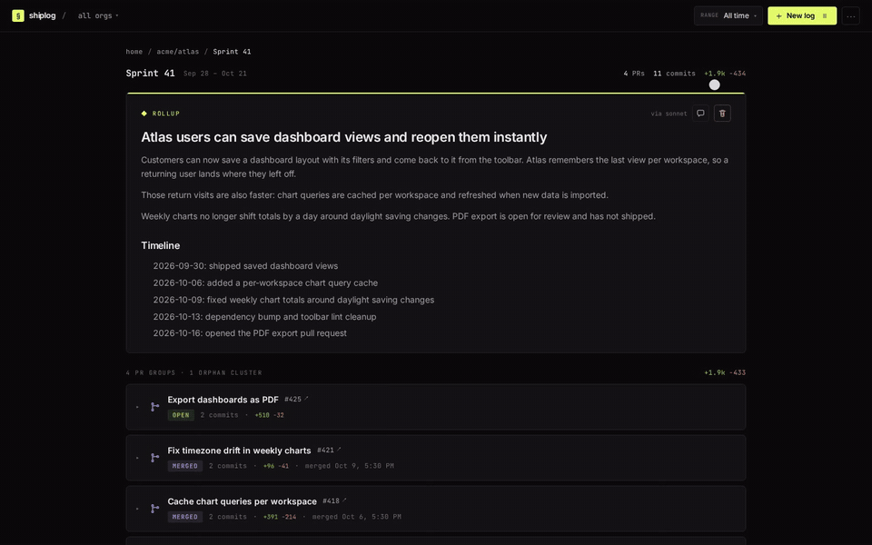

# shiplog

A free, open-source CLI tool that shows you **what you actually built** across your GitHub repositories. It fetches commits, PRs, and diffs, deduplicates them, and uses [ModelBridge](https://github.com/satyasaibhushan/ModelBridge) to generate human-readable summaries.

**No hosted backend or API key is required. Shiplog and ModelBridge run locally, and ModelBridge can use an existing CLI subscription.**

[](docs/demo/demo.webm)

The recording above is the real web UI running against fictional seeded data: the Acme repos, pull requests and people are made up, and the summaries are fixture text rather than model output. [Full-resolution video](docs/demo/demo.webm) · [poster frame](docs/demo/poster.png) · [how it was captured](#demo-capture).

The landing page at [docs/index.html](docs/index.html) uses the same video and poster. It is published as a static copy at <https://sai.bhushan.fun/projects/shiplog/>, and the shiplog card on the portfolio plays the same recording. GitHub Pages is not enabled for this repository; the page is owned here and copied to the portfolio for hosting.

shiplog exists to keep a curated record of shipped work for reviews, appraisal cycles and handoffs, instead of rebuilding it from memory each time. See [Vision & Roadmap](#vision--roadmap).

## Quick Start

> shiplog is not published to npm yet (the `shiplog` package on npm is an
> unrelated project) — install from source:

```bash
git clone https://github.com/satyasaibhushan/shiplog
cd shiplog
bun install
bun run build:all
bun link          # registers a global `shiplog` command

shiplog
```

Start ModelBridge in a second terminal before generating summaries:

```bash
git clone https://github.com/satyasaibhushan/ModelBridge
cd ModelBridge
bun install
bun start
```

Shiplog opens a local web UI at `http://localhost:3847` where you can select date ranges, repositories, and generate summaries.

Shiplog connects to `http://127.0.0.1:4141` by default. Override it with `MODELBRIDGE_URL`; if the service uses `MODELBRIDGE_TOKEN`, set the same value in Shiplog's environment.

## Prerequisites

| Tool | Purpose | Required? |
|------|---------|-----------|
| [Bun](https://bun.sh) | Runtime | Yes |
| [`gh` CLI](https://cli.github.com) | GitHub API access | Yes |
| [ModelBridge](https://github.com/satyasaibhushan/ModelBridge) | Shared model gateway | Yes |
| ModelBridge provider | Claude, Codex, Cursor, or Copilot CLI; optional Claude or Codex API key | One ready provider |

```bash
# Check your setup
shiplog setup
```

## Usage

### Web UI (default)

```bash
shiplog                          # Opens browser at localhost:3847
shiplog --port 8080              # Custom port
shiplog --no-browser             # Start server without opening browser
```

### Reports (persisted)

`shiplog report` runs the full pipeline for each repo, **saves** a log per
repo (plus a rollup across them) so everything shows up in the web UI, and
prints a project-wise markdown report to stdout. This is the building block
for scheduled daily/weekly routines — point a cron job or another automation
at it:

```bash
# Set the repos to track once
shiplog config trackedRepos owner/repo1,owner/repo2

shiplog report --daily                       # today's work
shiplog report --weekly                      # last 7 days
shiplog report -f 2024-01-01 -t 2024-03-31   # any range, project-wise

# One-off overrides
shiplog report --weekly -r owner/other-repo --title "Sprint 42"
shiplog report --daily -o json > report.json
```

Repos with no activity in the range are skipped. A rollup (the cross-project
overview) is only created when two or more repos had activity.

### Headless CLI (one-off, nothing saved)

Generate a report without a browser and without persisting anything:

```bash
# Markdown output
shiplog -o markdown -r owner/repo -f 2024-01-01 -t 2024-03-31

# JSON output (pipe to file)
shiplog -o json -r repo1,repo2 -f 2024-01-01 -t 2024-03-31 > report.json

# Standalone HTML report
shiplog -o html -r owner/repo -f 2024-01-01 -t 2024-03-31 > report.html
```

### Options

```
-f, --from <date>        Start date (YYYY-MM-DD, default: 30 days ago)
-t, --to <date>          End date (YYYY-MM-DD, default: today)
-r, --repos <repos>      Comma-separated repo list (owner/repo)
-o, --output <format>    Output: web, markdown, html, json
-p, --port <number>      Server port (default: 3847)
--llm <provider>         ModelBridge provider id (default: auto)
--no-browser             Don't open browser
-h, --help               Show help
-v, --version            Show version
```

### Configuration

Settings are stored at `~/.shiplog/config.json`:

```bash
shiplog config                      # View current config
shiplog config llm codex-cli        # Set ModelBridge provider
shiplog config port 8080            # Set server port
shiplog config --reset              # Reset to defaults
```

| Key | Values | Default |
|-----|--------|---------|
| `llm` | `auto`, `claude-cli`, `codex-cli`, `cursor-cli`, `copilot-cli`, `claude-api`, `codex-api` | `auto` |
| `port` | `1-65535` | `3847` |
| `theme` | `dark`, `light` | `dark` |
| `defaultScope` | comma-separated | `merged-prs,direct-commits` |
| `excludePatterns` | comma-separated globs | `*.lock,*.generated.*` |
| `trackedRepos` | comma-separated `owner/repo` | (empty) |

## Vision & Roadmap

shiplog is growing from a summary generator into a complete, curated record of
engineering work:

1. **A career-long work log.** Backfill and maintain a log of everything built
   over the last 4 years across company repositories. Each log entry accepts
   review comments, so summaries can be regenerated until the output matches
   what actually happened — the log is curated, not just generated.

2. **Automated reporting routines.** Scheduled routines generate
   a report every day and every week covering what shipped in that window —
   no manual triggering.

3. **Timerange reports, project-wise.** Given any date range, produce a report
   of all work done in that range, grouped by project — for reviews, appraisal
   cycles, or handoffs.

4. **Task Finder integration.** [Task Finder](https://github.com/satyasaibhushan/Task-Finder)
   is a companion desktop app that aggregates work items from Jira, Gmail, and
   Slack into one prioritized task list. Syncing shiplog task-wise against it
   captures the work GitHub never sees — client tickets, one-off data requests —
   and gives the code produced across repos its business context.

> **Persistence — decision deferred.** Everything currently lives in plain
> local files: JSON entities under `~/.shiplog-data/` plus the SQLite cache at
> `~/.shiplog/cache.sqlite`. There is no git sync or remote datastore. A
> proper datastore (durable journal vs disposable cache, backup story) will be
> chosen once the reporting workflows above have settled — the file layout is
> good enough until then.

## How It Works

```
You run shiplog
  → Fetches your GitHub repos via `gh` CLI
  → You select date range, repos, scope
  → Fetches commits + PRs + diffs
  → Deduplicates by patch-id (catches cherry-picks)
  → Groups into PR groups + orphan clusters
  → Sends each summary prompt to ModelBridge (map phase)
  → Creates roll-up summary (reduce phase)
  → Displays interactive results in browser
```

### Caching

All data is cached in `~/.shiplog/cache.sqlite`:

- **Commit diffs** are cached by SHA (immutable, never re-fetched)
- **LLM summaries** are cached by content hash (skips LLM on repeat runs)
- Re-running the same query is near-instant after the first run

### Scope Filters

| Scope | What it includes |
|-------|-----------------|
| Merged PRs | Completed, shipped work |
| Open PRs | Work in progress |
| Closed PRs | Abandoned / rejected PRs |
| Direct commits | Pushes not part of any PR |

## Tech Stack

| Layer | Technology |
|-------|-----------|
| Runtime | Bun |
| Server | Hono |
| Frontend | React 19 + Tailwind CSS v4 |
| Database | SQLite (bun:sqlite) + Drizzle ORM |
| Charts | Recharts |
| External | `gh` CLI, local ModelBridge service |

## Development

```bash
git clone <repo-url>
cd shiplog
bun install

# Build the frontend (use build:all, not build)
bun run build:all

# Run in dev mode
bun run start          # or: bun run dev (hot reload)
```

> **Build the web assets with `bun run build:all`, not `bun run build`.**
> `build` only emits `main.js` and `styles.css`; `build:all` also copies
> `index.html` into `dist/web/`. The server serves the UI from
> `dist/web/index.html`, so without it the page returns `404 Not Found`.
> Note that `dev`/`start` do **not** rebuild assets — re-run `build:all`
> after changing anything under `src/web/`.

### Running from source

The `setup`, `config`, and `sync` commands in this README assume shiplog is
installed globally. When running from a cloned repo, pass the subcommand
through the `start` script instead:

```bash
bun run start setup            # = shiplog setup
bun run start config llm codex # = shiplog config llm codex
```

To use the `shiplog` command directly, link the package globally:

```bash
bun link                       # registers a global `shiplog` -> ./src/cli/index.ts
```

If you then get `zsh: command not found: shiplog`, bun's global bin directory
isn't on your `PATH`. Add it to your shell profile (`~/.zshrc` or `~/.bashrc`):

```bash
export BUN_INSTALL="$HOME/.bun"
export PATH="$BUN_INSTALL/bin:$PATH"
```

Then reload your shell (`source ~/.zshrc`) or open a new terminal.

## Demo capture

The README GIF, video and poster come from `docs/demo/capture.ts`, which drives the real web UI in Chromium:

```bash
bun install
bunx playwright install chromium   # skip if Chromium for Playwright is already installed
bun run build:all
bun docs/demo/capture.ts           # writes docs/demo/poster.png, demo.webm and demo.gif
```

The script creates a scratch directory, seeds it with `docs/demo/seed.ts` through shiplog's own entity and cache code, and starts the real server with two stand-ins so no real account can leak into the recording: `docs/demo/bin/gh` answers the read-only GitHub calls the UI makes on load with fictional repos, and `docs/demo/modelbridge-stub.ts` reports a ready provider so the prerequisite check passes. Neither stand-in generates anything, so compiling a new log in this setup fails by design.

Encoding needs an ffmpeg build with `libvpx-vp9`. The script uses `FFMPEG`, then `ffmpeg` on `PATH`, then Playwright's bundled ffmpeg. The GIF also needs the `palettegen` filter, which Playwright's build lacks; with that build the GIF step is skipped.

## Status and limitations

- Not on npm yet; install from source as shown in Quick Start.
- Generating logs needs `gh` with an authenticated account and a running ModelBridge with at least one ready provider.
- Data lives in local files only (`~/.shiplog/` and `~/.shiplog-data/`); the long-term datastore is still undecided.
- The hosted app described below is private and owner-only; it is not a public demo.

## License

MIT


## Optional private Vercel application

The repository also includes a private hosted snapshot-reporting app with owner Google sign-in and durable PostgreSQL versions. It preserves the local CLI above. See [hosted deployment prerequisites and limits](docs/hosted-deployment.md). Run `bun run dev:hosted` for that application; `bun run build:hosted` builds it. Production requires an approved database and OAuth configuration. No source ingestion, scheduling or model spend is activated by hosted mode.
